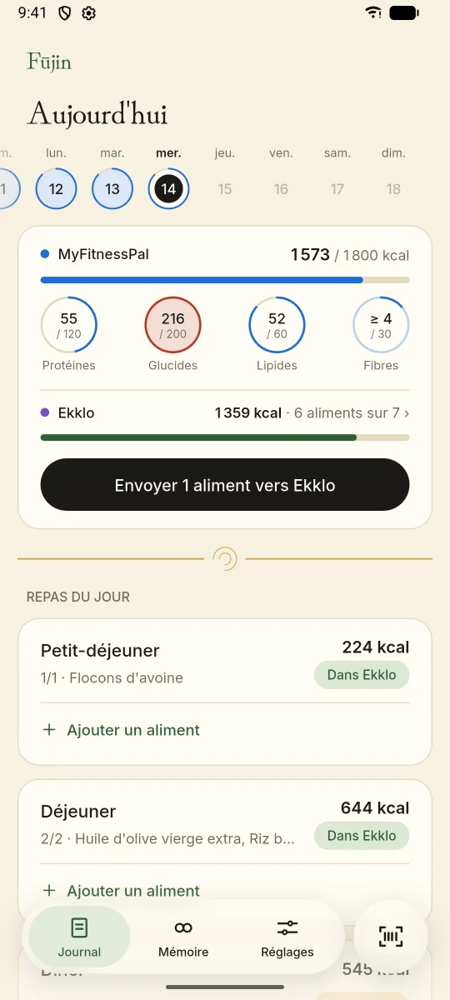
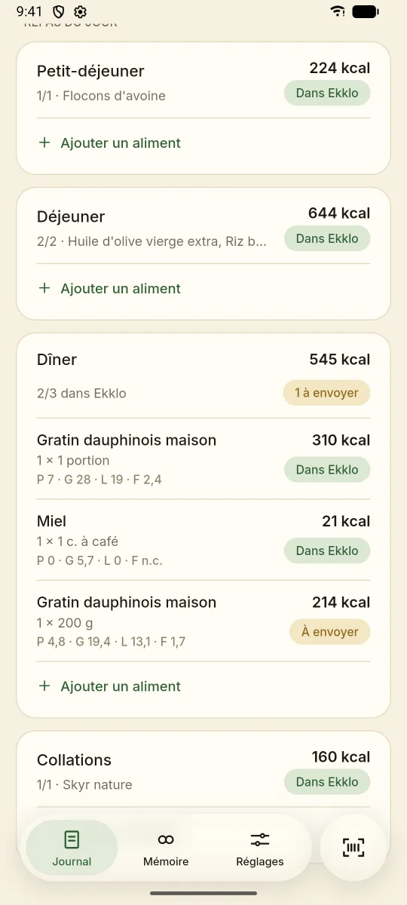
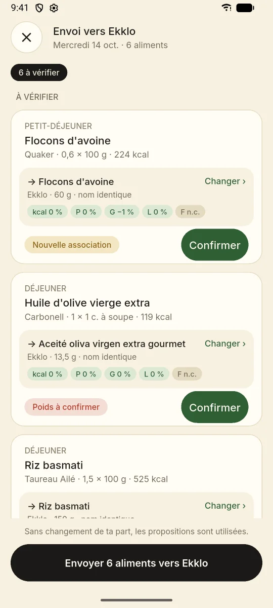
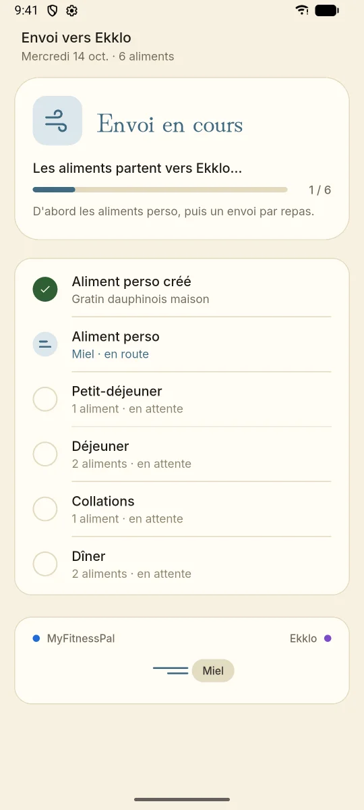
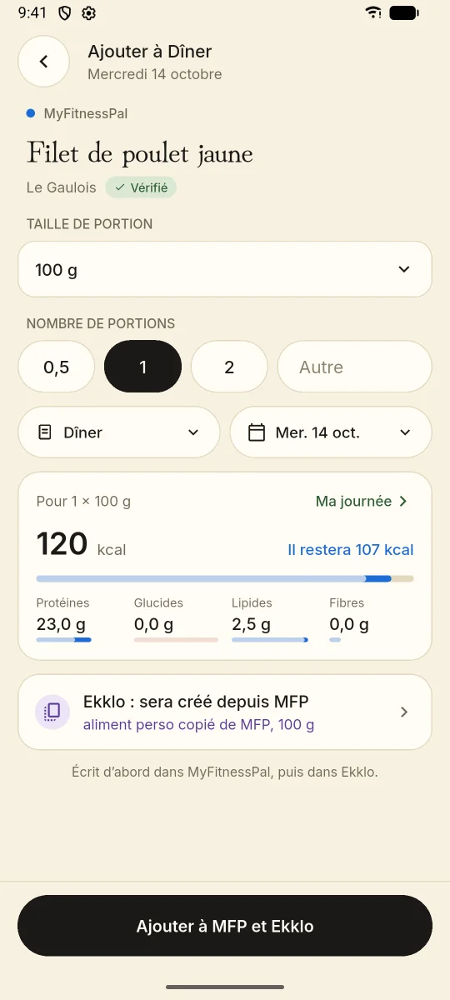
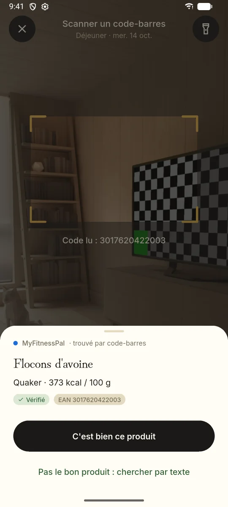
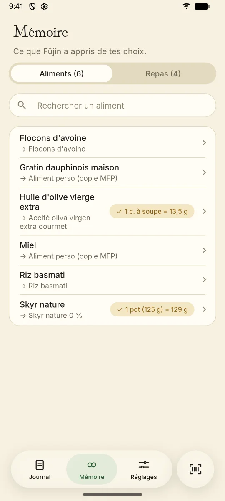
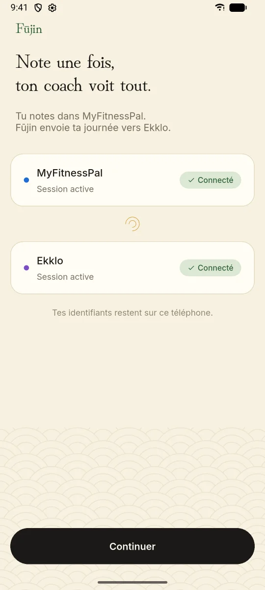
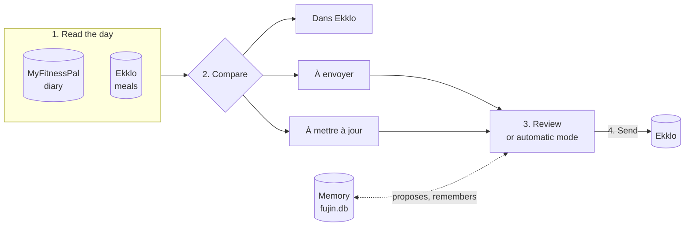
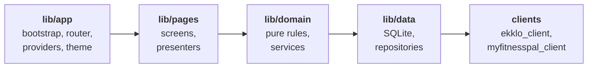

<div align="center">


# Fūjin

**Log your day once in MyFitnessPal. Your coach sees it in Ekklo.**

A personal Flutter app that copies its owner's MyFitnessPal food diary into Ekklo, the nutrition app his coach follows.

[](https://flutter.dev)
[](https://dart.dev)


[](docs/adr/README.md)

[Screens](#screens) · [How it works](#how-it-works) · [Features](#features) · [Getting started](#getting-started) · [Architecture](#architecture) · [Documentation](#documentation)

</div>

## Screens

<table>
  <tr>
    <td align="center" width="25%"><br><sub><b>Journal</b><br>Both apps side by side, a goal ring per day</sub></td>
    <td align="center" width="25%"><br><sub><b>Meals</b><br>A status per entry, done meals folded</sub></td>
    <td align="center" width="25%"><br><sub><b>Review</b><br>Each entry with its proposed Ekklo food</sub></td>
    <td align="center" width="25%"><br><sub><b>Send</b><br>Own copies first, then one write per meal</sub></td>
  </tr>
  <tr>
    <td align="center"><br><sub><b>Add a food</b><br>Written to MyFitnessPal, then Ekklo</sub></td>
    <td align="center"><br><sub><b>Scanner</b><br>Barcode looked up in MyFitnessPal</sub></td>
    <td align="center"><br><sub><b>Memory</b><br>Every choice, editable</sub></td>
    <td align="center"><br><sub><b>Welcome</b><br>Two sign-ins, credentials stay on the phone</sub></td>
  </tr>
</table>

<sub>Taken on the Android emulator against local fake servers: every food and figure is made up. The app speaks French, with an English translation for English devices.</sub>

## How it works

Fūjin keeps no queue and no sync state of its own. Each time a day is shown it reads both services, recomputes every status from what it finds ([ADR 0001](docs/adr/0001-recompute-statuses-from-both-sides.md)), and only writes after the owner has reviewed the foods, or straight away in automatic mode.



| Status | Meaning |
| --- | --- |
| **Dans Ekklo** | The MyFitnessPal entry is already in Ekklo, sent by Fūjin or adopted when found there. |
| **À envoyer** | The entry is not in Ekklo yet. |
| **À mettre à jour** | The entry changed in MyFitnessPal after it was sent. |

Adding a food goes the other way: one draft, written to MyFitnessPal first and then to Ekklo, with an "Annuler" snackbar that removes it from both ([ADR 0002](docs/adr/0002-write-ordering.md)).

## Features

| Feature | What it does | Decision |
| --- | --- | --- |
| **Journal** | Swipeable week band with a goal ring per day; MyFitnessPal kilocalories and macros against the goals; Ekklo progress; meals with a status per entry. Pull to refresh, re-read on return to the foreground, neighbour weeks read ahead. When one app fails the other stays readable; offline, the last figures stay on screen. | [0022](docs/adr/0022-journal-states-and-goal-rings.md), [0003](docs/adr/0003-refresh-on-foreground-and-pull.md), [0029](docs/adr/0029-journal-reads-held-for-display.md) |
| **Send** | Ekklo search and ranking of candidates, sheets to choose a food, set a unit's weight or create an own copy, then one write per Ekklo meal with progress, a summary and an interrupted state. Entries edited in MyFitnessPal are updated. | [0018](docs/adr/0018-send-flow.md) |
| **Automatic mode** | Sends without review, remembers none of the choices it made alone, and lists them with "Revoir" to keep them. | [0025](docs/adr/0025-automatic-mode.md) |
| **Add a food** | MyFitnessPal search, foods recently added through Fūjin, serving, meal, date and nutrients against the day's goals, with the send flow's Ekklo sheets. Each failure has its own screen. | [0026](docs/adr/0026-adding-a-food.md) |
| **Scanner** | Full-screen camera from the tab bar or the search, a keypad for a typed code, the meal of the hour preselected. A confirmed barcode is remembered. | [0027](docs/adr/0027-barcode-scanner.md) |
| **Memory** | Remembered foods, unit weights, meal mappings and barcode links. The Mémoire tab changes a food's Ekklo match, edits unit weights and meal mappings, or forgets a food so the next send asks again. | [GLOSSARY](GLOSSARY.md) |
| **Goals** | Daily kilocalories, protein, carbohydrates, fat and fibre. | [0020](docs/adr/0020-goals.md) |
| **Backup** | Android Auto Backup limited to `fujin.db`, plus a JSON backup file to export and import. | [0005](docs/adr/0005-backup.md), [0021](docs/adr/0021-backup-file.md) |
| **Dev app** | "Fūjin DEV" installs next to the real app and runs on real accounts in read-only mode. | [0017](docs/adr/0017-read-only-dev-environment.md) |

## Getting started

Requires the Flutter and Dart versions in the badges above, and an Android device or emulator.

```sh
flutter pub get
flutter test
flutter run --flavor production
```

Every build names a flavor; a build without one throws at startup.

| Flavor | App | Package | Writes to MyFitnessPal and Ekklo |
| --- | --- | --- | --- |
| `production` | Fūjin | `dev.oznel.fujin` | Yes |
| `dev` | Fūjin DEV, red "DEV" ribbon, own data and sessions | `dev.oznel.fujin.dev` | No, read-only on the phone ([ADR 0017](docs/adr/0017-read-only-dev-environment.md)) |

To run against local fake servers instead of the real services, redirect the base URIs with `--dart-define`; see [AGENTS.md](AGENTS.md#running-without-real-accounts).

In VS Code or Cursor, the Run and Debug panel offers both apps from `.vscode/launch.json`: "Fūjin" and "Fūjin DEV".

Generated files (mappers, localizations, theme tokens) are committed; the commands that regenerate them and the checks to run before handing work back are in [AGENTS.md](AGENTS.md#commands).

## Architecture

Each layer depends only on the layers to its right ([ADR 0013](docs/adr/0013-layers.md)).



| Concern | Choice | Decision |
| --- | --- | --- |
| State | `hooks_riverpod` 3 and `flutter_hooks`, notifiers as presenters | [0006](docs/adr/0006-riverpod-notifiers-as-presenters.md) |
| Navigation | `go_router`, a tab shell | [0010](docs/adr/0010-go-router-navigation.md), [0019](docs/adr/0019-tab-shell.md) |
| Models | `dart_mappable` | [0007](docs/adr/0007-dart-mappable-models.md) |
| Storage | One SQLite file, `fujin.db`, with migrations | [0004](docs/adr/0004-one-sqlite-file.md) |
| Sessions | Secure storage | [0011](docs/adr/0011-sessions-in-secure-storage.md) |
| Look and motion | Design tokens generated into Dart, motion with `motor`, controls drawn by Fūjin | [0008](docs/adr/0008-theme-from-design-tokens.md), [0028](docs/adr/0028-fujin-drawn-controls.md) |
| Copy | gen-l10n, French template and English translation | [0015](docs/adr/0015-french-and-english-copy.md) |
| Tests | `flutter_test` and `package:checks`, test doubles only at process edges | [0012](docs/adr/0012-test-doubles-at-process-edges.md) |

## Documentation

| Document | Contents |
| --- | --- |
| [AGENTS.md](AGENTS.md) | Commands, layers, where code goes, working rules |
| [GLOSSARY.md](GLOSSARY.md) | Domain terms and screen codes |
| [docs/adr/](docs/adr/README.md) | Architecture decision records |

## Third-party notices

- Fonts: Inter and Hina Mincho, from Google Fonts, under the SIL Open Font License; see `assets/fonts/inter/OFL.txt` and `assets/fonts/hinamincho/OFL.txt`.
- Agent skills vendored from Matt Pocock's skills repository (github.com/mattpocock/skills) under the MIT license; see `.agents/skills/THIRD_PARTY.md`.
